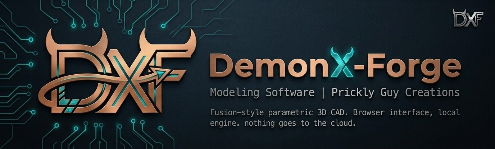

<p align="center">
  
</p>
# DemonX Forge

A Fusion-style parametric 3D CAD application, by Prickly Guy Creations. Sketch, extrude, fillet, hole and pattern features on an editable timeline, with named parameters, in a browser interface that looks and feels like DemonX CNC and DemonX Design. It runs locally on your own computer; nothing goes to the cloud.

**Status: skeleton.** The viewport, face picking, parameter editing and a click-to-drill command work against a demo part. There are no sketch tools, timeline or file menu yet. See `docs/PLAN.md`.

Parts leave Forge as STEP, STL, 3MF or DXF files, to be opened in any other program (DemonX Design for 2.5D CAM, a slicer, another CAD).

## How it is built

A Node server runs a modelling engine as a hidden process (today SolidCraft's headless CLI, MIT OR Apache-2.0, behind our own `Engine` interface) and serves a React and Three.js interface. See `docs/evaluation/` for why and what was tried.

```bash
npm install
# the engine: put solidcraft-cli at data/engine/solidcraft-cli (or set FORGE_ENGINE), see docs/PLAN.md
npm run build && npm start      # http://127.0.0.1:8120
npm run dev:server              # and, in another terminal: npm run dev:web
npm run typecheck && npm test
```

## Licence

GPL-3.0-or-later (see `LICENSE`). The engine is a separate program under its own licence and is not part of this repository.
