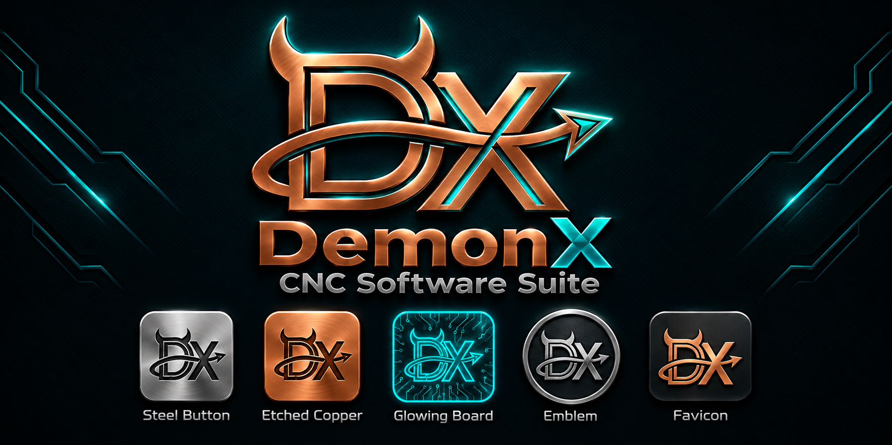

<p align="center">
  
</p>

# DemonX Forge

A Fusion-style parametric 3D CAD application, by Prickly Guy Creations. Sketch on a plane or a face, constrain and dimension, then extrude, revolve, sweep, loft, fillet, shell, drill, pattern and more, on an editable **timeline** with named **parameters**. It runs in your web browser, on your own computer: the server answers only this machine and nothing goes to the cloud.

It shares the look and feel of DemonX CNC and DemonX Design (the same slate and teal palette, dark and light), not their code. Parts leave Forge as STEP, STL, 3MF, OBJ or DXF files, to be opened in any other program (DemonX Design for 2.5D CAM, a slicer, another CAD). Parts come in as STEP, IGES, STL, OBJ or 3MF.

**Status:** usable and still growing. The owner tests each release on Windows; development and the automated checks run on Linux against the real modelling engine. Each release's notes (`docs/releases/`) say what was and was not tried.

## What it does

**Sketching** (SKETCH tab, Fusion's keys: L R C A D T O)
- Line, 2-point and centre rectangle, centre circle and 2-point circle, 3-point arc, slot; Trim, Extend, Offset (a whole connected outline moves, toward the pointer), sketch Fillet.
- Constraints: coincident, horizontal / vertical, parallel, perpendicular, tangent, equal, concentric, midpoint, fix. Sketch dimensions (lengths, diameters and radii, angles between lines, distances between points or from a point to a line) you can double-click to change, shown on the sketch with a check box to hide them.
- Drag to draw, or type the sizes into boxes on the shape. Snap hints as you draw: ends, centres, crossings, midpoints, and alignment with other points. Rubber-band selection (left to right: wholly inside; right to left: touching). Drag a point or a curve to move it.

**Solid features** (SOLID tab: CREATE and MODIFY)
- Create: Extrude (E, with a live preview and a drag arrow), Revolve, Sweep, Loft, Rib, Pipe, Coil, Emboss, Mirror, Rectangular and Circular Pattern, Hole (simple, counterbore, countersink; H).
- Modify: Fillet (F), Chamfer, Press Pull (Q; E on a selected face does the same), Shell, Offset Face, Draft, Combine (join, cut, intersect), Move / Copy (M, with X / Y / Z arrows, a step selector and turns), Split Body, Scale, Thread, Mesh to Solid.
- Pick the edges first and then press F (or Fillet), as in Fusion, or press the key first; type the number right after it. Measure (INSPECT tab, I) gives distances, angles, lengths and diameters between points, edges and faces.
- Select a face and press the key, or right-click anything for a menu of what applies. Every command is also on the ribbon, which wraps to a second row in a narrow window.

**Editing history**
- The timeline strip along the bottom and the browser tree on the left: double-click a step to change it (sketches, extrudes, fillets, hole values and more) and everything built on it rebuilds. Rename, suppress, roll history back, delete with a warning of what depends on it.
- Parameters: a named value (`width = 60`) that features use; change it in the browser and the part follows.
- Undo and redo (Ctrl+Z, Ctrl+Y).

**Files**
- `.forge` files: File > New, Open, Save, Save As, with the unsaved marker and a warning before you lose changes. Chrome and Edge give you the normal Windows file windows; other browsers download the file.
- Export: STEP, STL, 3MF, OBJ for bodies; DXF of a sketch, of a flat face, or of a section cut through a body (for DemonX Design or a laser / CNC program).
- Import: STEP and IGES (a new component), and **STL, OBJ and 3MF** as mesh bodies. A mesh import asks whether to centre the part on the origin on the floor.
- **Mesh to Solid** rebuilds a mesh as real, editable sketches and extrudes: parts made of flat steps and straight or evenly leaning walls along one main direction (plates, lips, ribs, drafted walls, round and slotted holes, rounded corners), with holes, countersinks and bosses across it. The result is checked against the mesh's volume; sculpted shapes are refused with a reason and nothing is changed. One Ctrl+Z takes it all back.

**Updates**
- The header shows the version you run. Forge checks GitHub's release list about once a day and shows an **Update** button when there is a newer release (File > Updates... has the notes). On the Windows package, **Update now** downloads the release zip, checks its checksum, unpacks it beside the running version and restarts into it; the old version is put back if the new one does not start. It refuses while the design has unsaved changes. Switching off the check stops Forge talking to the internet altogether.

**Letting an AI use it (MCP)**
- Forge has an MCP server, so Claude (Desktop, Code), OpenAI's Codex and other MCP clients can read the open design, run modelling commands, measure, take screenshots and undo, while you watch the window follow along. It cannot open, save or delete files. How to connect each one: [`docs/MCP.md`](docs/MCP.md).

**Mouse and keys**
- Wheel zooms toward the pointer; middle-drag pans; Shift + middle-drag orbits; the cube at the top right and the buttons under the view jump to standard views. `?` lists every key.
- Z is up. Lengths are millimetres and angles are degrees everywhere.

## Install (Windows)

1. Download `DemonX-Forge-<version>-windows-x64.zip` from the [Releases page](https://github.com/pricklyguy/DemonX-Forge/releases), right-click it, Properties, tick Unblock if offered.
2. Right-click, Extract All, type `C:\` as the place.
3. Open `C:\DemonX-Forge` and double-click `Start DemonX Forge.bat`. Your browser opens Forge (or go to `http://127.0.0.1:8120`).

Everything it needs is in the folder, including its own Node and the modelling engine; nothing else to install. `READ ME FIRST.txt` in the folder (`docs/WINDOWS.md`) has the first-run notes, how updating works and what to do if something goes wrong. After that, **Update now** in the app installs newer versions.

## Install (Linux)

Download `DemonX-Forge-<version>-linux-x64.tar.gz` from the Releases page, then:

```bash
cd ~ && tar -xzf ~/Downloads/DemonX-Forge-*-linux-x64.tar.gz
cd DemonX-Forge && ./start-forge.sh          # opens http://127.0.0.1:8120 in your browser
./install-launcher.sh                        # optional: menu entry, desktop icon, start at login
```

It carries its own Node and the engine (x86-64, Ubuntu 22.04 or newer). `docs/LINUX.md` is the step-by-step guide.

## Desktop icon and starting at login

On Windows, `Create Desktop Shortcut.bat` puts an icon on the desktop and `Start at login.bat` makes Forge start when you sign in; on Linux `install-launcher.sh` does both. Both ask whether Forge should also open the browser each time.

## Run it from the source

```bash
npm install
# the engine: put solidcraft-cli at data/engine/solidcraft-cli (or set FORGE_ENGINE), see docs/PLAN.md
npm run build && npm start      # http://127.0.0.1:8120
npm run dev:server              # and, in another terminal: npm run dev:web
npm run typecheck && npm test   # unit tests (several use the real engine and skip themselves without it)
npm run package:windows -- --engine-dir <dir>   # the Windows zip (or: node scripts/build-package.mjs --platform linux --engine-dir <dir>); CI does both on every tag
```

Browser checks (Playwright, real browser, real engine) are in `e2e/`; each script's header says how to run it and `e2e/README.md` lists them. Stop a test server by port (`fuser -k 8120/tcp`), never with `pkill -f`.

## How it is built

A Node server runs a modelling engine as a hidden process (today SolidCraft's headless CLI, MIT OR Apache-2.0, behind our own `Engine` interface in `server/src/engine/`) and serves a React and Three.js interface (`web/`). Every action is a command with JSON arguments, so the buttons, the browser checks and AI clients all do the same thing, and the server checks every request. Mesh to Solid is ours (`server/src/mesh/`): it cuts a mesh into slabs and features and has the engine extrude them. The Windows package keeps each version in its own folder so the program can update itself (`scripts/windows/launcher.mjs`, `server/src/update/`).

## Where things are written down

| | |
|---|---|
| `docs/PLAN.md` | Decisions with dates and reasons, engine findings, what each release added, what is next. Start here. |
| `docs/releases/` | Release notes for every version, with what was and was not tested. |
| `docs/WINDOWS.md` | The Windows guide that goes into the zip. |
| `docs/MCP.md` | Connecting Claude or OpenAI to Forge. |
| `docs/evaluation/` | Why SolidCraft's engine, and what was tried instead. |
| `e2e/README.md` | The browser checks. |
| `CLAUDE.md`, `AGENTS.md` | Notes for the AI assistants that work on the code. |

## Not here yet

Assemblies and joints, sheet metal, CAM, rendering and simulation (not planned); More import formats (FreeCAD, Rhino); dragging for fillet radius and hole position; Mesh to Solid for sculpted or uneven shapes; a Start menu entry and code signing for the Windows package; Update now on Linux; a package for macOS and for ARM computers such as the Raspberry Pi (it runs from source on both).

## Licence

GPL-3.0-or-later (see `LICENSE`). The engine is a separate program under its own licence, built from the commit pinned in `engine/SOLIDCRAFT_REF`; its licence files travel with it in the Windows package. We work clean-room: public documentation and observed behaviour only, never another CAD program's code or files.
